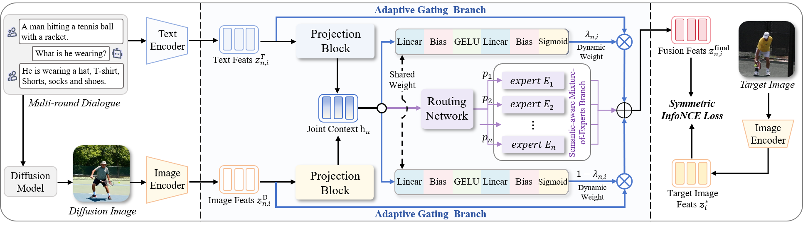

# ADaFuSE

ADaFuSE retrieves images from an evolving dialogue and a diffusion-generated illustration of the user's request. A learned gate and a mixture of experts combine the text and image embeddings so that visual details can contribute differently for each query. [SIGIR 2026 paper](https://doi.org/10.1145/3805712.3809836) · [Fusion module](adafuse.py).



## Set up BLIP and the data

The training script imports BLIP's `models` package and opens `blip_my/configs/med_config.json`. From the repository root, clone BLIP under that name. Use a PyTorch environment with compatible torchvision, timm and Transformers versions for BLIP.

```bash
git clone https://github.com/salesforce/BLIP.git blip_my
python -m pip install -r blip_my/requirements.txt
python -m pip install pandas openpyxl wandb tqdm
export PYTHONPATH="$PWD/blip_my${PYTHONPATH:+:$PYTHONPATH}"
```

| Input | Default path or format |
| --- | --- |
| BLIP/ChatIR retrieval weights | `blip_models/chatir_weights.ckpt` |
| [DAI-TIR training samples](https://drive.google.com/drive/folders/1JhXEoeiuwKNsVlm6LdJXFcbxYMcaJTw6?usp=sharing) | `dataset/visdial_1.0_train_sum_all.json` with `img` and `dialog` fields. Each `img` must resolve to a target image. |
| Generated training images | `dataset/query_images/round<r>/train-<target_stem>_<r>.jpg` |
| [ChatIR evaluation protocol](https://github.com/levymsn/ChatIR) | `ChatIR_Protocol/Search_Space_val_50k.json`, candidate images and `dialogues/VD-reformulated.json` |
| Generated validation images | `data/generated_images/<query_index>_<round>.jpg` |

## Train and validate

[blip_config.py](blip_config.py) sets the input paths, training mode and validation frequency. The default configuration performs end-to-end training with the ADaFuSE fusion strategy. From the same shell, inspect the command-line options or start a run with local logging:

```bash
python train_adafuse.py --help
python train_adafuse.py --experiment_name adafuse --wandb_mode disabled
```

[train_adafuse.py](train_adafuse.py) runs retrieval validation during training and compares text-only, image-only, DAR and fused-feature scores. With the example run name, look in `experiments_blip/adafuse/` for the configuration, validation workbook and saved checkpoints. This release links the training data and uses an external BLIP checkpoint. It does not supply a separate ADaFuSE checkpoint download.

## Citation and credits

Zhuocheng Zhang, Xingwu Zhang, Kangheng Liang, Guanxuan Li, Richard McCreadie and Zijun Long. *ADaFuSE: Adaptive Diffusion-generated Image and Text Fusion for Interactive Text-to-Image Retrieval*. SIGIR 2026, pp. 4349–4354. [Publisher record](https://doi.org/10.1145/3805712.3809836).

Code released February 14, 2026. The implementation builds on [BLIP](https://github.com/salesforce/BLIP), [VisDial](https://visualdialog.org/) and [ChatIR](https://github.com/levymsn/ChatIR). The authors described this project as MIT-licensed in the original release.
